# Práctica 1.4 — HTTPS con certificado autofirmado en Apache

## 1. Introducción y objetivo

En esta práctica he desplegado un servidor web Apache en una instancia EC2 de Amazon Web Services (AWS) y he configurado el protocolo HTTPS utilizando un certificado autofirmado generado con OpenSSL.

El objetivo ha sido instalar Apache, configurar el certificado SSL, habilitar HTTPS, establecer una redirección automática desde HTTP y comprobar que el servidor funciona correctamente tanto desde la propia instancia como desde mi equipo Windows.

También he organizado los archivos del proyecto mediante Git y GitHub, utilizando scripts Bash para automatizar la instalación y configuración del servidor.

Durante el desarrollo he realizado diferentes comprobaciones y he solucionado varios problemas relacionados con la conexión SSH, la autenticación de GitHub, la configuración del archivo `hosts` de Windows y la advertencia de seguridad del certificado autofirmado en Chrome.

## 2. Creación y configuración de la instancia EC2

Para realizar la práctica he utilizado AWS Academy Learner Lab.

He creado una instancia EC2 con la siguiente configuración:

| Parámetro | Configuración |
|---|---|
| Nombre de la instancia | HTTPS-IGM |
| Región | us-east-1 |
| Sistema operativo | Ubuntu Server 26.04.1 LTS |
| Tipo de instancia | t3.micro |
| Par de claves | HTTPS-Clave |
| IP pública / Elastic IP | 54.234.211.216 |
| IP privada | 172.31.18.175 |

### 2.1. Grupo de seguridad

He configurado el grupo de seguridad de la instancia para permitir las conexiones necesarias para la práctica.

Las reglas de entrada utilizadas son:

| Protocolo | Puerto | Función |
|---|---:|---|
| TCP | 22 | Conexión SSH al servidor |
| TCP | 80 | Acceso mediante HTTP |
| TCP | 443 | Acceso mediante HTTPS |

### 2.2. Asociación de la IP Elastica

He asociado una dirección Elastic IP a la instancia:

`54.234.211.216`

De esta forma, el servidor dispone de una dirección pública estable para acceder desde el equipo local y realizar las comprobaciones de HTTP y HTTPS.

## 3. Creación y organización del repositorio GitHub

He creado un repositorio privado en GitHub con el nombre:

**IGM-practica-01-04**

Repositorio:

https://github.com/ivangomezmo/IGM-practica-01-04

He clonado el repositorio en mi equipo Windows utilizando Git Bash y posteriormente también lo he clonado en la instancia EC2 para ejecutar los scripts directamente desde el servidor.

### 3.1. Clonado del repositorio en Windows

Desde Git Bash he ejecutado:

```bash
cd ~/Documents
git clone https://github.com/ivangomezmo/IGM-practica-01-04.git
cd IGM-practica-01-04
```

### 3.2. Autenticación en GitHub

Al tratarse de un repositorio privado, GitHub solicitó autenticación para poder clonarlo desde EC2.

Para solucionarlo utilicé un Personal Access Token (PAT) de GitHub.

El token se configuró con las siguientes características:

- Tipo: Fine-grained Personal Access Token.
- Propietario del repositorio: `ivangomezmo`.
- Acceso limitado al repositorio `IGM-practica-01-04`.
- Permisos de lectura de contenidos y metadatos.
- Caducidad de siete días.

El token permitió clonar el repositorio privado desde la instancia EC2.

Por seguridad, no se incluye el token en el repositorio ni en este documento.

## 4. Estructura del proyecto

He organizado los archivos del proyecto separando los scripts de instalación, las configuraciones de Apache y las variables de configuración.

La estructura utilizada es:

```text
IGM-practica-01-04/
│
├── README.md
├── .gitignore
│
├── conf/
│   ├── 000-default.conf
│   └── practica-https-ssl.conf
│
└── scripts/
    ├── .env.example
    ├── install_apache.sh
    └── setup_selfsigned_certificate.sh
```

Cada directorio tiene una función concreta:

- `conf/`: contiene los archivos de configuración de los VirtualHost de Apache.
- `scripts/`: contiene los scripts Bash y el ejemplo de variables de entorno.
- `.gitignore`: evita que determinados archivos privados o temporales se suban a GitHub.
- `README.md`: documenta el desarrollo de la práctica.

El archivo `scripts/.env` se creó directamente en la instancia EC2 y no se incluyó en el repositorio.

## 5. Preparación de los archivos del proyecto

### 5.1. Archivo `.gitignore`

He creado el archivo `.gitignore` para evitar que se suban archivos privados al repositorio.

Su contenido es:

```gitignore
# Variables privadas
scripts/.env

# Claves privadas y certificados
*.key
*.pem

# Archivos temporales
*.bak
*.swp
*~
```

De esta forma, Git ignora el archivo `.env`, las claves privadas, los archivos PEM y determinados archivos temporales.

### 5.2. Archivo `scripts/.env.example`

He creado un archivo de ejemplo con las variables necesarias para configurar el certificado y el servidor.

Contenido:

```bash
# Datos del certificado
COUNTRY="ES"
STATE="Cantabria"
LOCALITY="Torrelavega"
ORGANIZATION="IES Miguel Herrero"
ORGANIZATIONAL_UNIT="Informatica"
COMMON_NAME="practica-https.test"
EMAIL="admin@example.com"

# Configuracion del servidor
DOMAIN="practica-https.test"
ELASTIC_IP="54.234.211.216"
CERT_DAYS="365"

# Rutas del certificado
CERT_KEY="/etc/ssl/private/apache-selfsigned.key"
CERT_FILE="/etc/ssl/certs/apache-selfsigned.crt"
```

Estas variables se utilizan posteriormente para generar el certificado autofirmado y configurar Apache.

El archivo `.env.example` se guarda en GitHub porque sirve como ejemplo de configuración, mientras que el archivo real `.env` permanece fuera del repositorio.

### 5.3. Script `install_apache.sh`

He creado un script Bash para automatizar la instalación de Apache.

Contenido:

```bash
#!/bin/bash

set -e

# Instalar Apache si no está instalado

if dpkg -s apache2 >/dev/null 2>&1; then
    echo "Apache ya está instalado."
    exit 0
fi

echo "Instalando Apache..."

sudo apt-get update -y
sudo DEBIAN_FRONTEND=noninteractive apt-get install -y apache2

# Habilitar y arrancar Apache
sudo systemctl enable apache2
sudo systemctl start apache2

echo "Apache se ha instalado correctamente."
```

Este script realiza las siguientes operaciones:

1. Comprueba si Apache ya está instalado.
2. Si Apache está instalado, muestra un mensaje y finaliza.
3. Si no está instalado, actualiza la información de los paquetes.
4. Instala Apache mediante `apt-get`.
5. Habilita el servicio para que se inicie automáticamente.
6. Arranca el servicio Apache.

La instrucción `set -e` hace que el script finalice si se produce un error en alguno de los comandos ejecutados.

### 5.4. Script `setup_selfsigned_certificate.sh`

He creado un segundo script para generar el certificado autofirmado y configurar Apache para trabajar mediante HTTPS.

Contenido:

```bash
#!/bin/bash

set -e

# Comprobar que Apache está instalado
if ! dpkg -s apache2 >/dev/null 2>&1; then
    echo "Error: Apache no está instalado."
    echo "Ejecuta primero install_apache.sh."
    exit 1
fi

# Cargar variables del archivo .env
SCRIPT_DIR="$(cd "$(dirname "${BASH_SOURCE[0]}")" && pwd)"
ENV_FILE="$SCRIPT_DIR/.env"

if [ ! -f "$ENV_FILE" ]; then
    echo "Error: No se encuentra el archivo .env."
    exit 1
fi

source "$ENV_FILE"

# Comprobar variables necesarias
if [ -z "$DOMAIN" ] || [ -z "$ELASTIC_IP" ] || \
   [ -z "$COUNTRY" ] || [ -z "$STATE" ] || \
   [ -z "$LOCALITY" ] || [ -z "$ORGANIZATION" ] || \
   [ -z "$ORGANIZATIONAL_UNIT" ] || [ -z "$COMMON_NAME" ] || \
   [ -z "$EMAIL" ] || [ -z "$CERT_DAYS" ] || \
   [ -z "$CERT_KEY" ] || [ -z "$CERT_FILE" ]; then
    echo "Error: Faltan variables en el archivo .env."
    exit 1
fi

echo "Generando certificado autofirmado..."

# Crear certificado y clave privada
sudo openssl req -x509 -nodes -days "$CERT_DAYS" \
-newkey rsa:2048 \
-keyout "$CERT_KEY" \
-out "$CERT_FILE" \
-subj "/C=$COUNTRY/ST=$STATE/L=$LOCALITY/O=$ORGANIZATION/OU=$ORGANIZATIONAL_UNIT/CN=$COMMON_NAME/emailAddress=$EMAIL" \
-addext "subjectAltName=DNS:$DOMAIN,IP:$ELASTIC_IP"

# Permisos de seguridad
sudo chmod 600 "$CERT_KEY"
sudo chmod 644 "$CERT_FILE"

# Copiar configuraciones de Apache
sudo cp "$SCRIPT_DIR/../conf/000-default.conf" /etc/apache2/sites-available/000-default.conf
sudo cp "$SCRIPT_DIR/../conf/practica-https-ssl.conf" /etc/apache2/sites-available/practica-https-ssl.conf

# Sustituir el dominio en las configuraciones
sudo sed -i "s/practica-https.test/$DOMAIN/g" /etc/apache2/sites-available/000-default.conf
sudo sed -i "s/practica-https.test/$DOMAIN/g" /etc/apache2/sites-available/practica-https-ssl.conf

# Habilitar módulos y sitio HTTPS
sudo a2enmod ssl rewrite
sudo a2ensite practica-https-ssl.conf

# Comprobar configuración antes de reiniciar
sudo apache2ctl configtest

# Reiniciar Apache
sudo systemctl restart apache2

echo "Certificado y configuración HTTPS instalados correctamente."
```

Este script realiza las siguientes operaciones:

1. Comprueba que Apache está instalado.
2. Localiza el archivo `.env`.
3. Comprueba que existe el archivo de configuración.
4. Carga las variables de entorno.
5. Comprueba que las variables necesarias tienen contenido.
6. Genera un certificado autofirmado mediante OpenSSL.
7. Genera una clave RSA de 2048 bits.
8. Añade el dominio y la IP pública al SAN del certificado.
9. Establece los permisos de seguridad de la clave y el certificado.
10. Copia los archivos de configuración de Apache.
11. Sustituye el dominio en los archivos de configuración.
12. Habilita los módulos SSL y rewrite.
13. Habilita el sitio HTTPS.
14. Comprueba la sintaxis de Apache.
15. Reinicia el servicio.

### 5.5. Configuración HTTP: `conf/000-default.conf`

He configurado el VirtualHost del puerto 80 para redirigir las peticiones HTTP hacia HTTPS.

Contenido:

```apache
<VirtualHost *:80>

    ServerName practica-https.test
    DocumentRoot /var/www/html

    RewriteEngine On
    RewriteRule ^ https://%{HTTP_HOST}%{REQUEST_URI} [L,R=301]

</VirtualHost>
```

Esta configuración escucha en el puerto 80.

La directiva `RewriteEngine On` activa el módulo de reescritura y la regla `RewriteRule` redirige las peticiones hacia HTTPS.

El código de redirección utilizado es 301, que indica una redirección permanente.

### 5.6. Configuración HTTPS: `conf/practica-https-ssl.conf`

He creado un segundo VirtualHost para gestionar las conexiones HTTPS.

Contenido:

```apache
<VirtualHost *:443>

    ServerName practica-https.test
    DocumentRoot /var/www/html

    DirectoryIndex index.php index.html

    SSLEngine on
    SSLCertificateFile /etc/ssl/certs/apache-selfsigned.crt
    SSLCertificateKeyFile /etc/ssl/private/apache-selfsigned.key

    ErrorLog ${APACHE_LOG_DIR}/practica-https-error.log
    CustomLog ${APACHE_LOG_DIR}/practica-https-access.log combined

</VirtualHost>
```

Esta configuración escucha en el puerto 443.

Las directivas principales son:

- `ServerName`: establece el dominio del servidor.
- `DocumentRoot`: indica el directorio donde se encuentra la página web.
- `SSLEngine on`: habilita SSL.
- `SSLCertificateFile`: indica la ubicación del certificado.
- `SSLCertificateKeyFile`: indica la ubicación de la clave privada.
- `ErrorLog`: establece el archivo de registro de errores.
- `CustomLog`: establece el archivo de registro de accesos.

## 6. Conexión SSH a la instancia EC2

Una vez creada la instancia, me he conectado desde Git Bash utilizando la clave privada descargada de AWS.

El comando utilizado ha sido:

```bash
ssh -i ~/Downloads/HTTPS-Clave.pem ubuntu@54.234.211.216
```

El usuario utilizado para conectarme a Ubuntu es `ubuntu`.

### 6.1. Problema con la huella SSH

Durante la conexión apareció el siguiente error:

```text
REMOTE HOST IDENTIFICATION HAS CHANGED
```

El problema estaba relacionado con una huella SSH anterior almacenada para esa dirección IP.

Para solucionarlo ejecuté:

```bash
ssh-keygen -R 54.234.211.216
```

Después volví a conectarme mediante SSH y acepté la nueva huella del servidor tras comprobar el destino.

La conexión se realizó correctamente.

## 7. Clonado del repositorio en EC2

Una vez conectado al servidor, cloné el repositorio privado de GitHub mediante HTTPS.

Para ello utilicé el Personal Access Token temporal configurado anteriormente.

Después de clonar el repositorio, entré en el directorio del proyecto y preparé los scripts para poder ejecutarlos.

Ejecuté:

```bash
chmod +x scripts/install_apache.sh scripts/setup_selfsigned_certificate.sh
```

Este comando concede permisos de ejecución a los dos scripts Bash.

## 8. Instalación de Apache

Antes de configurar HTTPS, instalé Apache mediante el script creado para esta práctica.

Ejecuté:

```bash
./scripts/install_apache.sh
```

El script actualizó los paquetes e instaló Apache.

Después comprobé el estado del servicio:

```bash
sudo systemctl status apache2
```

El resultado mostró que Apache estaba funcionando correctamente:

```text
Active: active (running)
```

También comprobé que el servicio estaba habilitado para iniciarse automáticamente.

### 8.1. Comprobación de una segunda ejecución

Para comprobar que el script detectaba correctamente una instalación existente, lo ejecuté una segunda vez:

```bash
./scripts/install_apache.sh
```

El resultado fue:

```text
Apache ya está instalado.
```

Esto confirmó que el script no intentaba realizar de nuevo la instalación cuando Apache ya estaba presente.

## 9. Creación del archivo `.env`

Después de instalar Apache, creé el archivo `.env` a partir del ejemplo proporcionado en el repositorio.

Ejecuté:

```bash
cp scripts/.env.example scripts/.env
```

El archivo real contiene los datos utilizados durante la configuración:

- País: ES.
- Provincia: Cantabria.
- Localidad: Torrelavega.
- Organización: IES Miguel Herrero.
- Unidad organizativa: Informatica.
- Nombre común: `practica-https.test`.
- Dominio: `practica-https.test`.
- Elastic IP: `54.234.211.216`.
- Duración del certificado: 365 días.
- Ruta de la clave privada: `/etc/ssl/private/apache-selfsigned.key`.
- Ruta del certificado: `/etc/ssl/certs/apache-selfsigned.crt`.

El archivo `.env` se mantiene fuera del repositorio mediante `.gitignore`.

## 10. Generación del certificado autofirmado

Una vez creado el archivo `.env`, ejecuté el segundo script:

```bash
./scripts/setup_selfsigned_certificate.sh
```

El script generó el certificado autofirmado y configuró Apache para utilizarlo.

Durante su ejecución se habilitaron los módulos necesarios:

```bash
sudo a2enmod ssl rewrite
```

También se habilitó el sitio HTTPS:

```bash
sudo a2ensite practica-https-ssl.conf
```

Antes de reiniciar Apache, el script comprobó la sintaxis de la configuración.

El resultado obtenido fue:

```text
Syntax OK
Certificado y configuración HTTPS instalados correctamente.
```

Esto confirmó que Apache aceptaba la configuración y que el despliegue había terminado correctamente.

## 11. Comprobación del certificado generado

Para comprobar que el certificado se había generado correctamente, ejecuté:

```bash
sudo openssl x509 -in /etc/ssl/certs/apache-selfsigned.crt -noout -subject -dates -ext subjectAltName
```

El resultado mostró los siguientes datos:

| Campo | Resultado |
|---|---|
| País | ES |
| Provincia | Cantabria |
| Localidad | Torrelavega |
| Organización | IES Miguel Herrero |
| Unidad organizativa | Informatica |
| Common Name | practica-https.test |
| Inicio de validez | 4 de noviembre de 2026 |
| Fin de validez | 4 de noviembre de 2027 |
| SAN DNS | practica-https.test |
| SAN IP | 54.234.211.216 |

El certificado se generó con una duración de 365 días.

También se comprobó que el Subject Alternative Name (SAN) incluía tanto el dominio como la IP pública de la instancia.

Esto permite que el certificado contenga las identidades utilizadas para acceder al servidor.

## 12. Comprobaciones del funcionamiento de Apache

Después de generar el certificado, realicé varias comprobaciones para verificar que el servidor funcionaba correctamente.

### 12.1. Comprobación de la sintaxis

Ejecuté:

```bash
sudo apache2ctl configtest
```

El resultado fue:

```text
Syntax OK
```

Esto confirmó que la configuración de Apache no presentaba errores de sintaxis.

### 12.2. Comprobación de los puertos 80 y 443

Ejecuté:

```bash
sudo ss -tlnp | grep -E ':80|:443'
```

El resultado mostró que Apache estaba escuchando en los dos puertos:

- Puerto 80 para HTTP.
- Puerto 443 para HTTPS.

Esto confirmó que ambos servicios estaban preparados para recibir conexiones.

### 12.3. Comprobación de la redirección HTTP a HTTPS

Para comprobar que las peticiones HTTP se redirigían correctamente, ejecuté:

```bash
curl -I http://54.234.211.216
```

El resultado obtenido fue:

```text
HTTP/1.1 301 Moved Permanently
Location: https://54.234.211.216/
```

El código `301 Moved Permanently` confirmó que el servidor redirigía las peticiones HTTP hacia HTTPS.

### 12.4. Comprobación de HTTPS mediante la IP pública

A continuación comprobé la respuesta HTTPS directamente mediante la dirección IP pública:

```bash
curl -k -I https://54.234.211.216
```

El resultado fue:

```text
HTTP/1.1 200 OK
```

El código `200 OK` confirmó que el servidor respondía correctamente mediante HTTPS.

Se utilizó la opción `-k` porque el certificado es autofirmado y no está emitido por una autoridad certificadora reconocida por el cliente.

### 12.5. Comprobación de la conexión TLS

También realicé una comprobación adicional mediante OpenSSL:

```bash
openssl s_client -connect 54.234.211.216:443 -servername practica-https.test </dev/null
```

La conexión se estableció correctamente y se negoció:

- Protocolo TLS 1.3.
- Cifrado `TLS_AES_256_GCM_SHA384`.
- Clave RSA de 2048 bits.

Al finalizar apareció:

```text
Verify return code: 18 (self-signed certificate)
```

Este resultado es esperado porque el certificado utilizado está autofirmado.

La conexión TLS se estableció, pero el cliente no puede verificar la confianza del certificado mediante una autoridad certificadora reconocida.

## 13. Configuración del archivo `hosts` de Windows

Para poder acceder al servidor mediante el dominio `practica-https.test`, configuré el archivo `hosts` de Windows.

La ruta del archivo es:

```text
C:\Windows\System32\drivers\etc\hosts
```

Añadí la siguiente línea:

```text
54.234.211.216 practica-https.test
```

Con esta entrada, Windows resuelve el dominio local hacia la IP pública de la instancia EC2.

### 13.1. Problema al guardar el archivo

Inicialmente guardé la modificación en un archivo llamado `hosts.txt`, en lugar de modificar el archivo original `hosts`.

Posteriormente abrí el archivo correcto y guardé la línea en su ubicación original, utilizando el editor con los permisos necesarios.

Después de corregirlo, el dominio resolvió correctamente a la dirección IP pública.

### 13.2. Comprobación mediante ping

Ejecuté:

```bash
ping practica-https.test
```

El dominio resolvió a:

```text
54.234.211.216
```

Sin embargo, las solicitudes ICMP agotaron el tiempo de espera.

Esto no significa que el servidor HTTPS no funcione. El tráfico ICMP puede estar bloqueado por la configuración de red o por el grupo de seguridad de AWS.

La comprobación definitiva del servicio se realizó mediante `curl` y el navegador.

## 14. Comprobación HTTPS desde Windows

Una vez corregido el archivo `hosts`, realicé una prueba desde Git Bash en Windows utilizando el dominio.

Ejecuté:

```bash
curl -k -I https://practica-https.test
```

El resultado obtenido fue:

```text
HTTP/1.1 200 OK
```

Esto confirmó que podía acceder al servidor mediante HTTPS utilizando el dominio configurado localmente.

## 15. Comprobación final desde Google Chrome

Finalmente abrí Google Chrome y accedí a:

```text
https://practica-https.test
```

El navegador mostró una advertencia de privacidad:

```text
NET::ERR_CERT_AUTHORITY_INVALID
```

Esta advertencia aparece porque el certificado utilizado es autofirmado y Chrome no reconoce su emisor como una autoridad certificadora de confianza.

Para continuar con la comprobación de laboratorio, accedí a las opciones avanzadas del navegador y continué hacia el sitio.

Después se mostró correctamente la página predeterminada de Apache:

**Apache2 Default Page — It works!**

Esto confirmó que el servidor web estaba funcionando y que podía accederse mediante HTTPS desde el navegador.

La advertencia del certificado es un comportamiento esperado en esta práctica. En un entorno de producción se debería utilizar un certificado emitido por una autoridad certificadora reconocida.

## 16. Problemas encontrados y soluciones aplicadas

Durante la realización de la práctica encontré varios problemas que fui solucionando.

| Problema | Solución aplicada |
|---|---|
| Error `REMOTE HOST IDENTIFICATION HAS CHANGED` al conectarme por SSH | Eliminé la huella anterior con `ssh-keygen -R 54.234.211.216` y volví a conectarme. |
| Autenticación al clonar el repositorio privado | Utilicé un Personal Access Token de GitHub limitado al repositorio. |
| Apache ya estaba instalado al ejecutar el script por segunda vez | El script detectó la instalación existente y mostró el mensaje correspondiente. |
| Chrome mostró `NET::ERR_CERT_AUTHORITY_INVALID` | Continué mediante las opciones avanzadas para realizar la comprobación del certificado autofirmado. |
| El ping al dominio no recibió respuesta | Comprobé que el dominio resolvía correctamente y verifiqué HTTPS mediante `curl`. |
| Guardé inicialmente el archivo como `hosts.txt` | Modifiqué el archivo original `hosts` de Windows y guardé correctamente los cambios. |

Estos problemas permitieron comprobar diferentes aspectos de la configuración y entender mejor el funcionamiento de SSH, GitHub, DNS local, Apache y los certificados SSL.

## 17. Evidencias de la práctica

### 1. Instancia EC2 creada
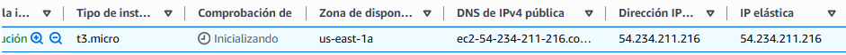

### 2. Estado del servicio Apache
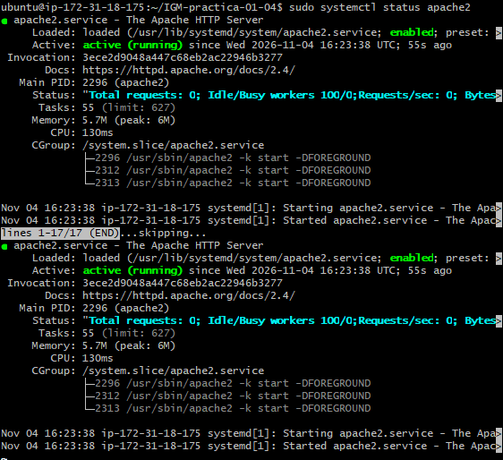

### 3. Comprobación de instalación de Apache
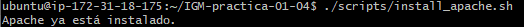

### 4. Generación e instalación del certificado autofirmado
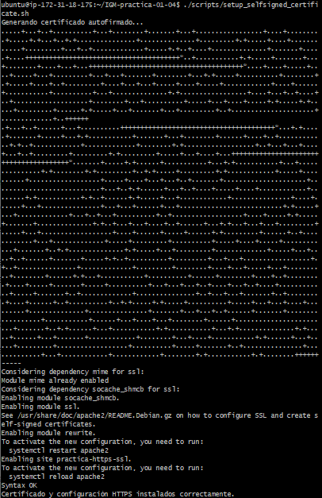

### 5. Datos del certificado y nombres alternativos
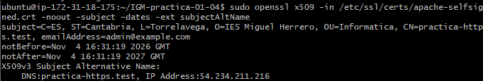

### 6. Comprobación de configuración de Apache
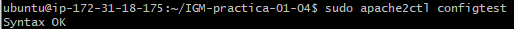

### 7. Puertos HTTP y HTTPS escuchando
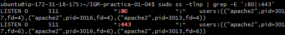

### 8. Redirección de HTTP a HTTPS
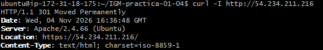

### 9. Prueba de acceso HTTPS mediante IP
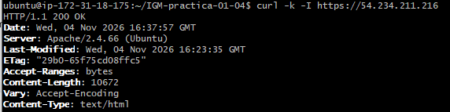

### 10. Prueba de acceso HTTPS mediante dominio
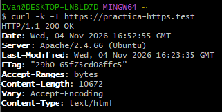

### 11. Aviso del certificado autofirmado en Chrome
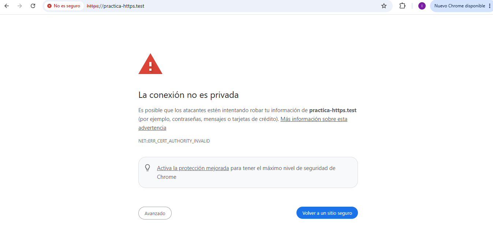

### 12. Página predeterminada de Apache
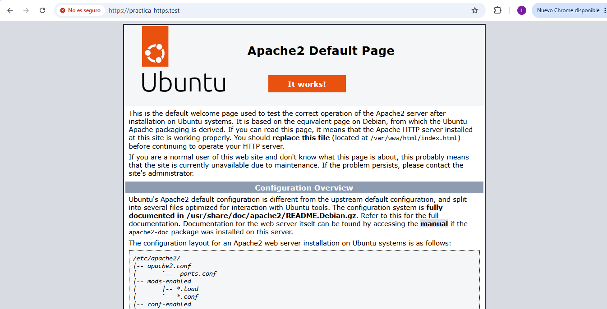

## 18. Subida de los cambios a GitHub

Una vez preparados los archivos del proyecto, realicé la subida de los cambios al repositorio remoto.

El primer commit del proyecto fue:

```text
b07b21e Añadir scripts y configuracion HTTPS
```

Para actualizar la documentación y subir los cambios utilicé los comandos de Git desde el directorio local del proyecto.

Primero comprobé el estado:

```bash
git status
```

Después añadí el README:

```bash
git add README.md
```

Añadí también los archivos de configuración y scripts:

```bash
git add .gitignore conf/ scripts/.env.example scripts/install_apache.sh scripts/setup_selfsigned_certificate.sh
```

Creé el commit:

```bash
git commit -m "Documentar practica HTTPS con certificado autofirmado"
```

Finalmente, subí los cambios a la rama principal:

```bash
git push origin main
```

El repositorio utilizado para almacenar el proyecto es:

https://github.com/ivangomezmo/IGM-practica-01-04

## 19. Resultado final

He conseguido desplegar correctamente un servidor Apache en la instancia EC2 `HTTPS-IGM` de AWS y habilitar el acceso mediante HTTPS utilizando un certificado autofirmado.

Las comprobaciones realizadas han confirmado que:

- Apache está instalado y funcionando.
- Los puertos 80 y 443 están escuchando.
- El certificado autofirmado se ha generado correctamente.
- El certificado incluye el dominio y la IP pública en el SAN.
- La configuración de Apache devuelve `Syntax OK`.
- Las peticiones HTTP se redirigen a HTTPS mediante una respuesta 301.
- Las peticiones HTTPS devuelven una respuesta 200.
- El dominio `practica-https.test` resuelve hacia la IP pública.
- Se puede acceder al servidor desde Windows mediante HTTPS.
- Chrome muestra correctamente la página predeterminada de Apache después de superar la advertencia del certificado autofirmado.

Por tanto, considero completada la configuración y comprobación del servidor HTTPS solicitada en la práctica.

## 20. Consideraciones de seguridad

Durante la práctica se han utilizado algunas medidas para mantener protegidos los archivos y credenciales:

- El archivo `.env` no se incluye en GitHub.
- Las claves privadas y archivos PEM están excluidos mediante `.gitignore`.
- El token de GitHub no se ha incluido en el código ni en la documentación.
- La clave privada de AWS se utiliza únicamente para establecer conexiones SSH.

El certificado autofirmado utilizado tiene una finalidad educativa y de laboratorio. Para publicar un servicio real en Internet se debe utilizar un certificado emitido por una autoridad certificadora reconocida y comprobar siempre la validez de la conexión.
